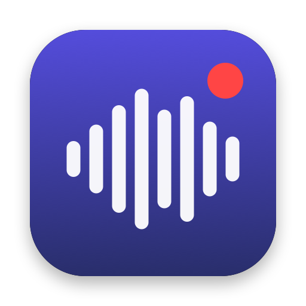

<p align="center"></p>

<h1 align="center">MeetNotes</h1>

<p align="center">Free, private meeting transcription for macOS.<br>
No bot joins your call, no audio leaves your Mac.</p>

---

MeetNotes records your side (the microphone) and everyone else (the call audio from Zoom, Google Meet,
Teams, Slack or anything else) as two separate tracks, then transcribes them on your Mac with
NVIDIA's Parakeet model running on the Neural Engine. You get a timestamped transcript with who said what,
saved as plain files you own.

## Features

- **Works with any call app.** It records system audio, so there is nothing to install in Zoom or Meet
  and no bot in the participant list.
- **On-device speech recognition** in 25 European languages, including English, Ukrainian, Polish,
  German, French and Spanish. An hour-long meeting takes about a minute to transcribe.
- **Tells speakers apart.** Several people on the call get their own labels (Speaker 1, Speaker 2…),
  which you can rename to real names in one click, with suggestions from the calendar invite.
- **No headphones needed.** When your microphone picks up the other people from your speakers,
  MeetNotes removes that echo from your track, so lines are not duplicated.
- **Scheduled meetings** from the macOS Calendar (Google, iCloud, Exchange, Outlook): record in one
  click with the event's title and attendees, and get a notification with a Record button when a
  meeting starts.
- **Plain files.** Each meeting is a folder in `~/MeetingNotes` with the audio, `transcript.md` and
  `transcript.json`, ready for your notes app or an AI assistant.
- **Never records the screen.** It asks only for the microphone and "System Audio Recording Only".
- English and Ukrainian interface. Automatic updates.

## Install

1. Download the latest `MeetNotes-<version>.dmg` from
   [Releases](https://github.com/paulshnurenko/free-meeting-transcription/releases/latest).
2. Open it and drag MeetNotes to Applications.
3. Start a recording from the menu bar. macOS asks for the **Microphone** and
   **System Audio Recording Only** permissions the first time.
4. The first transcription downloads the speech model (about 500 MB, once).

Requires macOS 15 or later on Apple Silicon. The app is signed and notarized by Apple.

### Google Calendar

MeetNotes reads meetings from the macOS Calendar, so it needs no access to your Google account. Add the
account in **System Settings → Internet Accounts → Google**, turn on **Calendars**, then click
**Connect Calendar…** in MeetNotes. In Settings you can choose which calendars to show.

## Privacy

Recording, echo removal and speech recognition all run on your Mac. MeetNotes sends nothing anywhere.
The only network requests are the one-time model download from Hugging Face and update checks against
this repository's releases.

Recording other people may require their consent where you live. Let participants know when you record.

## Meeting folders

```
~/MeetingNotes/2026-10-28_14-00_sprint-planning/
├── mic.wav            your microphone, 16 kHz mono
├── system.wav         call audio, 16 kHz mono
├── transcript.md      **[00:01:05] Me:** …
├── transcript.json    [{"start", "end", "speaker", "text"}]
└── meta.json          title, start time, duration, calendar event, attendees
```

The folder can be changed in Settings.

## Known limitations

- Speakers are told apart by voice, not by name: rename them in the transcript. Very similar voices,
  or people sharing one microphone in a room, may be merged.
- The transcript appears after the recording stops, not live.
- If you and the other side talk over each other without headphones, a few of your words can be lost.

## Building from source

You need Xcode 26 or later (with its license accepted) on an Apple Silicon Mac.

```bash
scripts/build-app.sh        # → build/MeetNotes.app
open build/MeetNotes.app
```

The build is signed with your Developer ID certificate if you have one, otherwise ad-hoc (then macOS asks
for permissions again after every rebuild).

To re-transcribe a recorded meeting without the UI:

```bash
swift run meetnotes-cli process ~/MeetingNotes/<meeting folder>
```

Code layout:

| Path | What it does |
|---|---|
| `Sources/MeetNotesCore/Recorder.swift` | Core Audio process tap for call audio, AVAudioEngine for the mic |
| `Sources/MeetNotesCore/EchoRemoval.swift` | Mutes the speakers' sound picked up by the mic |
| `Sources/MeetNotesCore/Transcriber.swift` | Parakeet through FluidAudio, speech chunking |
| `Sources/MeetNotesCore/Diarizer.swift` | Who spoke when on the call audio (pyannote + WeSpeaker + VBx) |
| `Sources/MeetNotesCore/Transcript.swift` | Merging tracks, dropping echo duplicates and fillers |
| `Sources/MeetNotesCore/Calendar.swift` | Scheduled meetings from EventKit |
| `Sources/MeetNotes/` | SwiftUI app: menu bar, meetings window, settings, updates |
| `Resources/uk.lproj/` | Ukrainian translation |

### Releasing

`scripts/release.sh <version>` builds, signs, notarizes and packages `dist/MeetNotes-<version>.dmg` and
`dist/appcast.xml`. Publish both as assets of a GitHub release tagged `v<version>`, not marked as a
pre-release: the app checks the appcast of the latest release. The script header lists the one-time setup.

## Contributing

Issues and pull requests are welcome. Please describe how to reproduce a problem, and for transcription
issues mention the meeting language and whether you used headphones. Translations go to
`Resources/<language>.lproj/Localizable.strings`, keyed by the English text.

## Acknowledgements

- [Parakeet TDT 0.6B v3](https://huggingface.co/nvidia/parakeet-tdt-0.6b-v3) by NVIDIA, licensed under
  [CC BY 4.0](https://creativecommons.org/licenses/by/4.0/)
- [FluidAudio](https://github.com/FluidInference/FluidAudio) by FluidInference (Core ML port of Parakeet),
  Apache License 2.0
- [pyannote](https://github.com/pyannote/pyannote-audio) segmentation and
  [WeSpeaker](https://github.com/wenet-e2e/wespeaker) speaker embeddings (through FluidAudio) for telling speakers apart
- [Sparkle](https://sparkle-project.org) for updates, MIT License

## License

[MIT](LICENSE) © 2026 Pavlo Shnurenko
